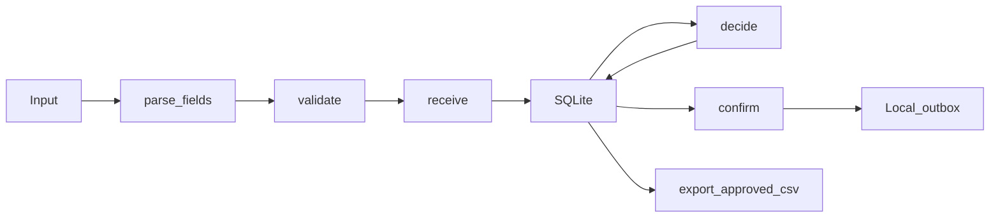

# SYNTHETIC WhatsApp order workflow proof

## Problem
Incomplete order messages need follow-up, corrections, and owner review before confirmation.
This personal code sample demonstrates that core workflow offline. It is proof of skill,
not past client work or evidence of a deployed WhatsApp service.

## One command
From this folder, with Python 3.11 or newer:

```powershell
python order_intake.py
```

Standard library only. No installation, API keys, accounts, or network calls.
Inputs in `synthetic_inputs.json` are labelled SYNTHETIC. Contact values are
non-dialable placeholders; there are no real customers, phone numbers, or invoices.
Messages use explicit `key=value` fields, not natural-language AI extraction.
The SQLite database is in memory by default. Each run starts fresh.

The scripted demo collects missing details, blocks premature confirmation,
simulates an owner correction request, changes quantity, simulates approval,
and writes a local confirmation outbox record. It then prints an approved-orders CSV.
CSV can be copied into a spreadsheet; this is not a Google Sheets integration.
`Workflow(database_path)` supports file-backed SQLite, verified by the inherited test.

## Real output
VERIFIED 4 Nov 2026: captured directly from `python order_intake.py` during this build.

```text
SYNTHETIC DATA ONLY. No real customers, phone numbers, invoices, or network calls.
{"classification": "SYNTHETIC", "order": "SYNTHETIC_ORDER_ALPHA", "question": "Please provide/correct: size, address, phone", "status": "waiting_for_details"}
{"classification": "SYNTHETIC", "order": "SYNTHETIC_ORDER_ALPHA", "question": null, "status": "waiting_for_approval"}
Confirmation blocked: owner approval required
SIMULATED OWNER REQUEST: waiting_for_details
{"classification": "SYNTHETIC", "order": "SYNTHETIC_ORDER_ALPHA", "question": null, "status": "waiting_for_approval"}
SIMULATED OWNER DECISION: approved
SYNTHETIC confirmation for SYNTHETIC_ORDER_ALPHA; local outbox only; nothing sent.
SQLite orders: 1
Local outbox records: 1
SYNTHETIC approved-orders CSV (local output only):
classification,order_id,item,quantity,size,address,phone,status
SYNTHETIC,SYNTHETIC_ORDER_ALPHA,SYNTHETIC_TSHIRT,3,M,SYNTHETIC_ADDRESS_ALPHA,SYNTHETIC_PHONE_ALPHA,approved
```

## Actual code flow
Generated by `python order_intake.py --diagram`; names match the workflow methods
and storage in `order_intake.py`. A test checks that this README matches that output.



`receive` merges fields and validates before saving a waiting state. `decide`
requires complete data and a waiting-for-approval state. A correction returns the
order to waiting-for-details. `confirm` requires approved state and inserts one
outbox record per order. `export_approved_csv` reads approved orders only and
uses CSV quoting. Export does not send confirmations or mutate orders.

## Tests

```powershell
python -B -m unittest discover -v
```

See `VALIDATION.md` for captured before/after counts and reviewed source commits.

## Origin
The intake core and its 15 tests were copied from
[the existing personal demo](https://github.com/asadullah48/whatsapp-order-intake-demo/tree/98472ac34bfff350d5cb6af61c9de645e28c022d).
This sibling sample adds the scripted correction/reapproval path, approved-only
CSV export, and focused export tests. It is not an independent client implementation.
See `PROOF_REVIEW.md` for the offer and repository assessment.

## Limits
- No WhatsApp Business API, webhook, Google Sheets API, or real message delivery.
- No LLM or real-model mode; deterministic parsing only.
- Owner actions are scripted and the actor string is a local simulation, not authentication.
- No owner web screen, deployment, production retries, concurrency handling, or webhook deduplication.
- Confirmation is a local outbox insert. Export is printed CSV, not a saved Sheet.
- Synthetic prefix checks are demonstration constraints, not a personal-data detector.
- One synthetic product, sizes S/M/L, and quantity range 1..100.
- This proves a bounded workflow, not all features in any paid offer package.
