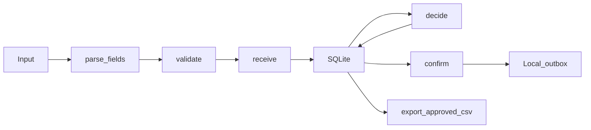

# SYNTHETIC WhatsApp order workflow proof

[](https://github.com/asadullah48/whatsapp-order-proof-demo/actions/workflows/test.yml)

## Problem
Incomplete order messages need follow-up, corrections, and owner review before confirmation.
This personal code sample demonstrates that core workflow offline. It is proof of skill,
not past client work or evidence of a deployed WhatsApp service. Despite the name,
nothing here connects to WhatsApp.

## Run it
From this folder, with Python 3.11 or newer:

```powershell
python -m pip install -e .
python -m order_intake                                # scripted SYNTHETIC demo
python -m order_intake --audit-log audit.jsonl        # same, plus a JSONL export of the audit table
python -m order_intake --diagram                      # Mermaid flow below
```

No runtime dependencies; the core uses only the Python standard library. No API keys,
accounts, or network calls on the default path. Inputs in
`src/order_intake/synthetic_inputs.json` are labelled SYNTHETIC. Contact values are
non-dialable placeholders; there are no real customers, phone numbers, or invoices.
The SQLite database is in memory by default, so each run starts fresh.

The scripted demo collects missing details, blocks premature confirmation,
simulates an owner correction request, changes quantity, simulates approval,
and writes a local confirmation outbox record. It then prints an approved-orders CSV.
CSV can be copied into a spreadsheet; this is not a Google Sheets integration.

## How it is built
| Piece | File | What it does |
| --- | --- | --- |
| State machine | `src/order_intake/state.py` | `State` enum and a `(state, event) -> state` table. Any move not in the table raises `IllegalTransition` (a `ValueError`). `approved` and `rejected` have no exits. |
| Workflow | `src/order_intake/workflow.py` | `receive`, `decide`, `confirm`, `export_approved_csv` over SQLite. Every status change goes through the table. |
| Audit log | `audit` table in `workflow.py` | One row per state change: `time` (UTC), `order`, `from`, `to`, `actor`. Inserted on the same SQLite connection and transaction as the state change, so both commit or neither does. SQLite triggers reject `UPDATE`/`DELETE` on the table. `export_audit_jsonl()` (and `--audit-log PATH`) writes it out as JSONL; the file is an export, not the record. |
| Parsers | `src/order_intake/parsers.py` | `MessageParser` protocol. Default `KeyValueParser` reads explicit `key=value;...` fields. Whatever any parser returns passes `check_schema` (known fields only, non-empty strings) and then the same business `validate` before it touches an order. A parser cannot set `status`. |
| Optional LLM parser | `LLMParser` in `parsers.py` | Off by default. Needs `pip install -e ".[llm]"`, the `ORDER_INTAKE_ANTHROPIC_API_KEY` env var, **and** `--parser llm`. Its output is untrusted and goes through the same schema check. **This code path has never been executed** (see Verified). |

States: `new` → `waiting_for_details` ⇄ `waiting_for_approval` → `approved` | `rejected`;
`correct` sends `waiting_for_approval` back to `waiting_for_details`.

## Real output
Captured from `python -m order_intake` on 20 Nov 2026 (Python 3.12.13). It is
identical to the output captured from the original single-file script on 4 Nov 2026.

```text
SYNTHETIC DATA ONLY. No real customers, phone numbers, invoices, or network calls.
{"classification": "SYNTHETIC", "order": "SYNTHETIC_ORDER_ALPHA", "question": "Please provide/correct: size, address, phone", "status": "waiting_for_details"}
{"classification": "SYNTHETIC", "order": "SYNTHETIC_ORDER_ALPHA", "question": null, "status": "waiting_for_approval"}
Confirmation blocked: owner approval required
SIMULATED OWNER REQUEST: waiting_for_details
{"classification": "SYNTHETIC", "order": "SYNTHETIC_ORDER_ALPHA", "question": null, "status": "waiting_for_approval"}
SIMULATED OWNER DECISION: approved
SYNTHETIC confirmation for SYNTHETIC_ORDER_ALPHA; local outbox only; nothing sent.
SQLite orders: 1
Local outbox records: 1
SYNTHETIC approved-orders CSV (local output only):
classification,order_id,item,quantity,size,address,phone,status
SYNTHETIC,SYNTHETIC_ORDER_ALPHA,SYNTHETIC_TSHIRT,3,M,SYNTHETIC_ADDRESS_ALPHA,SYNTHETIC_PHONE_ALPHA,approved
```

The same run with `--audit-log` wrote 5 lines (then appended directly to a file; it is now an export of the audit table, same line format), the first being:

```text
{"actor": "SYNTHETIC_CUSTOMER", "from": "new", "order": "SYNTHETIC_ORDER_ALPHA", "time": "2026-11-20T17:16:43.814032+00:00", "to": "waiting_for_details"}
```

## Actual code flow
Generated by `python -m order_intake --diagram`; names match the workflow methods
and storage in `src/order_intake/workflow.py`. A test checks that this README matches that output.



`receive` merges fields and validates before saving a waiting state. `decide`
requires complete data and a waiting-for-approval state. A correction returns the
order to waiting-for-details. `confirm` requires approved state and inserts one
outbox record per order. `export_approved_csv` reads approved orders only and
uses CSV quoting. Export does not send confirmations or mutate orders.

## Tests

```powershell
python -m pip install -e ".[dev]"
ruff check .
python -m pytest
```

113 tests, run locally on Python 3.11, 3.12, 3.14 on 20 Nov 2026. GitHub CI has not run yet.

- `tests/test_order_intake.py` (19): the inherited workflow and CSV export tests.
- `tests/test_state.py` (40): all 16 illegal `(state, event)` pairs at table level, the 13
  reachable ones through the public API with a no-mutation check, all 9 legal moves, table shape.
- `tests/test_audit.py` (6): audit rows are written in the same SQLite transaction as the
  state change, and the JSONL export equals the observed state history. A failure-injection
  test lets the real audit insert run, then raises, for both `receive` and `decide`; re-reading
  the database file on a fresh connection shows neither the state change nor the audit row
  was committed. Triggers block `UPDATE` and `DELETE` on the audit table. Rows persist across
  instances; the demo writes the export.
- `tests/test_parsers.py` (48), using a fake parser with sockets blocked: parser output can
  never approve or confirm an order (`"approve"`, `"status=approved"`, smuggled
  `status`/`decision`/`actor` keys, or a fully valid order, sent as customer or as owner); only
  the exact owner actor can approve (seven near-miss actor values are refused); malformed
  output (non-objects, JSON strings, non-string or empty values, unknown or mis-cased keys) is
  rejected by the schema check.

No test calls the network or the LLM parser.

## Verified
Only what was actually run, on Windows, 20 Nov 2026:

- `python -m pytest`: **113 passed, 10 subtests passed** on Python 3.11.15 and 3.12.13
  (fresh venvs, `pip install -e ".[dev]"`) and on Python 3.14.
- `ruff check .`: clean with ruff 0.17.6 and 0.15.12.
- `python -m order_intake`: output above; `--audit-log` wrote 5 lines; `--diagram` matches this README (tested).
- `pip install -e .` in a fresh venv, then the `order-intake` console script, ran the demo from outside the repo.
- `--parser llm` without the key env var exits with `RuntimeError` before any import or call.

Not verified:
- The GitHub Actions workflow has not run on GitHub yet, so the badge may show no status.
- `LLMParser.parse` has never been executed, `pip install -e ".[llm]"` was not run, and no request
  has been sent to any model. Treat it as unexercised code, not a working feature.
- Linux/macOS (CI targets Ubuntu, but has not run yet).

[docs/history/VALIDATION.md](docs/history/VALIDATION.md) and [docs/history/HANDOVER.md](docs/history/HANDOVER.md)
are dated records from the earlier single-file version; their `python order_intake.py` /
`unittest` commands no longer work.

## Limits
- No WhatsApp Business API, webhook, Google Sheets API, or real message delivery.
- Default parsing is deterministic `key=value`; it does not understand free text.
- Owner actions are scripted and the actor string is a local simulation, not authentication.
  Audit `actor` values are therefore claims, not verified identities.
- The audit table is append-only through SQLite triggers, not tamper-evident: no hashing or
  signing, and anyone with write access to the database file can drop the triggers or edit rows.
  The JSONL export is a plain file with no protection at all.
- No concurrency handling: two writers on one SQLite file or one log file are not coordinated.
- Confirmation is a local outbox insert. Export is printed CSV, not a saved Sheet.
- Synthetic prefix checks are demonstration constraints, not a personal-data detector.
- One synthetic product, sizes S/M/L, and quantity range 1..100.
- This proves a bounded workflow, not all features in any paid offer package.

## Not built yet
- WhatsApp (or any messaging) integration, webhooks, retries, deduplication.
- Real owner authentication and an owner web screen.
- A live-tested LLM parser, an eval set for it, or any measured extraction accuracy.
- Tamper-evident audit storage (hash chain or signing) or audit retention/rotation.
- Deployment of any kind.

## Origin
The intake core and its 15 tests were copied from
[the existing personal demo](https://github.com/asadullah48/whatsapp-order-intake-demo/tree/98472ac34bfff350d5cb6af61c9de645e28c022d).
This sibling sample adds the scripted correction/reapproval path, approved-only
CSV export, the explicit state machine, the audit log, and the parser interface.
It is not an independent client implementation.
See `PROOF_REVIEW.md` for the offer and repository assessment.

## License
MIT. See `LICENSE`.
